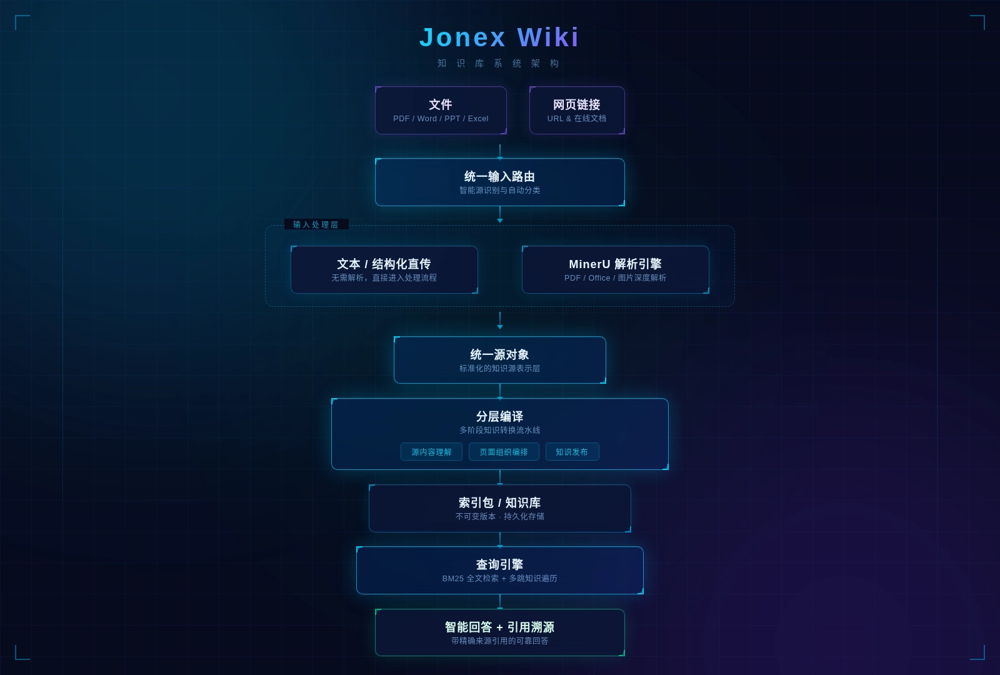

<p align="center">
  <strong>Jonex Wiki</strong><br />
  面向企业知识库的 LLM-Wiki 编译与问答服务
</p>

<hr />
<br />

<p align="center">
  
  
  
  
  
</p>

<p align="center">
  <a href="README.md">English</a> | 中文
</p>

<p align="center">
  <a href="#概览">概览</a> |
  <a href="#快速开始">快速开始</a> |
  <a href="#cli-参考">CLI 参考</a> |
  <a href="#docker">Docker</a> |
  <a href="#配置">配置</a> |
  <a href="#http-api">HTTP API</a> |
  <a href="#许可证">许可证</a>
</p>

<p align="center">
  <strong>
  如果你认可 Jonex 的价值，欢迎点亮 ⭐ Star，支持项目持续迭代！
  </strong>
</p>

---

## 概览

Jonex Wiki 是一个独立的 **LLM-Wiki** 服务：把文档解析成结构化来源，编译成可增量更新的 Wiki bundle，再通过检索与多跳遍历回答问题，并返回可追溯的引用。

它不依赖特定的前端或平台，既可以作为独立 HTTP 服务运行，也可以作为一个 Python 包嵌入其他应用。日常使用通过 `jonex-wiki` CLI 完成：上传、编译、查询、查看任务和页面都不需要手写 HTTP 请求。

<p align="center">
  
</p>

### 特性

- **多模态输入**：`.txt`、`.md`、`.json`、`.csv`、`.xlsx` 等走确定性归一化；PDF、DOCX、PPTX、图片、HTML 走 MinerU。
- **分层编译**：来源理解与页面组织分离，支持增量编译、单文档重编译、不可变 bundle 与版本回滚。
- **可追溯引用**：答案中的引用绑定到具体文档、chunk、页码/位置与原文摘录。
- **检索**：内置 BM25 词法检索、证据句柄与多跳遍历；不依赖向量库。
- **异步任务**：上传、解析、编译、查询都是任务，支持轮询、取消与中断恢复。

## 快速开始

### 环境要求

| 依赖 | 要求 |
| --- | --- |
| Python | 3.12+ |
| [uv](https://docs.astral.sh/uv/) | 最新版 |
| PostgreSQL | 可选；本地体验可直接用 SQLite |
| LLM | 任意 OpenAI-compatible `/v1` 服务 |
| MinerU | 可选；解析 PDF / Office / 图片时需要 |

### 1. 克隆仓库

```bash
git clone https://github.com/yuezhiai/jonex-wiki.git
cd jonex-wiki
uv sync
```

可选：激活虚拟环境后可以直接使用 `jonex-wiki`，否则用 `uv run jonex-wiki`。

```bash
source .venv/bin/activate
```

> 下文示例默认已激活虚拟环境；如果没有激活，把命令里的 `jonex-wiki` 换成 `uv run jonex-wiki` 即可。

### 2. 配置服务端

```bash
cp .env.example .env
```

本地最小配置（SQLite + 任意 OpenAI-compatible LLM）：

```dotenv
JONEX_WIKI_API_KEY=change-me
DATABASE_URL=sqlite+aiosqlite:///./jonex_wiki.db
JONEX_WIKI_DATA_ROOT=./.results

LLM_BINDING_HOST=https://api.openai.com/v1
LLM_BINDING_API_KEY=sk-your-key
LLM_MODEL=gpt-4o-mini

# 只有解析 PDF / Office / 图片时才需要
MINERU_API_TOKEN=
```

> `LLM_BINDING_HOST` 只要是 OpenAI-compatible 的 `/v1` 地址即可，不要求项目自带的网关。
> 如果上游不支持顶层 `thinking` 字段，引擎会自动去掉该字段重试。

### 3. 初始化数据库

```bash
uv run alembic upgrade head
```

SQLite 与 PostgreSQL 都支持。PostgreSQL 下请同时设置 `DB_HOST`、`DB_PORT`、`DB_USERNAME`、`DB_PASSWORD`、`DB_NAME`、`DB_SCHEMA`，或直接用 `DATABASE_URL` 覆盖。

### 4. 启动服务

```bash
uv run jonex-wiki-api
# 默认 0.0.0.0:8007；可用 JONEX_WIKI_API_PORT 覆盖
```

另开一个终端配置 CLI。`JONEX_WIKI_API_KEY` 必须与服务端 `.env` 中的值一致：

```bash
export JONEX_WIKI_BASE_URL=http://127.0.0.1:8007
export JONEX_WIKI_API_KEY=change-me
export JONEX_WIKI_TENANT_ID=demo
```

检查服务：

```bash
jonex-wiki status
# healthz: {'ok': True}
# readyz:  {'ok': True}
```

### 5. 上传、编译、查询

上传一个 Markdown 文件（不依赖 MinerU），等待解析完成，并继续等待解析器自动排入的编译：

```bash
jonex-wiki upload ./my-doc.md --kb demo --wait --compile
```

`--compile` 隐含 `--wait`。如果只上传、不等待：

```bash
jonex-wiki upload ./my-doc.md --kb demo
# uploaded: document_id=doc-... task_id=task-...
```

也可以单独触发编译；如果已有编译在跑，会复用同一个任务：

```bash
jonex-wiki compile --kb demo --wait
```

编译完成后提问。`query` 默认等待答案：

```bash
jonex-wiki query "这个项目是做什么的？" --kb demo
```

输出包含答案和引用：

```text
task=qry-... kind=query status=done

Answer:
...答案正文...

Citations:
  [E1] topics/overview.md
    ...原文摘录...
```

需要更深的遍历或多跳时：

```bash
jonex-wiki query "对比这两份文档的差异" --kb demo --thinking-mode deep
```

只想先提交任务、稍后再取结果：

```bash
jonex-wiki query "..." --kb demo --no-wait
# query: task_id=qry-...
jonex-wiki task qry-... --wait
```

查看已发布 Wiki 的页面：

```bash
jonex-wiki pages --kb demo
```

## CLI 参考

所有命令都支持 `--json`，适合脚本消费。连接参数可以放在子命令前，也可以放在子命令后：

```bash
jonex-wiki --json pages --kb demo
jonex-wiki pages --kb demo --json
```

| 命令 | 作用 |
| --- | --- |
| `jonex-wiki status` | 检查 `/healthz` 与 `/readyz` |
| `jonex-wiki upload FILE --kb KB [--wait] [--compile]` | 上传文件并触发解析；`--compile` 继续等编译 |
| `jonex-wiki compile --kb KB [--wait]` | 触发全库编译；已有任务时复用 |
| `jonex-wiki query QUESTION --kb KB [--thinking-mode fast\|standard\|deep] [--no-wait]` | 提问；默认等待答案 |
| `jonex-wiki task TASK_ID [--wait]` | 查看任务状态或查询结果 |
| `jonex-wiki pages --kb KB` | 列出已发布 Wiki 页面 |

通用参数：

| 参数 | 说明 |
| --- | --- |
| `--base-url URL` | 服务地址，默认读 `JONEX_WIKI_BASE_URL`，否则 `http://127.0.0.1:8007` |
| `--api-key KEY` | API key，默认读 `JONEX_WIKI_API_KEY` |
| `--tenant ID` | 租户标识，默认读 `JONEX_WIKI_TENANT_ID`，否则 `default` |
| `--json` | 输出原始 JSON |
| `--wait-timeout SEC` | 等待任务完成的超时，默认 1800 |
| `--poll-interval SEC` | 任务轮询间隔，默认 1 |
| `--http-timeout SEC` | 单次 HTTP 请求超时，默认 60 |

CLI 只调用 HTTP API，不直接读写引擎数据库，所以必须先启动 `jonex-wiki-api`。CLI 默认忽略 `HTTP_PROXY` / `HTTPS_PROXY` / `NO_PROXY`，避免本机代理配置影响对服务地址的访问。

## Docker

```bash
cp .env.example .env
# 填入 JONEX_WIKI_API_KEY、LLM_BINDING_*、可选 MINERU_API_TOKEN
docker compose up --build -d
```

Compose 默认使用 SQLite，数据落在 `data` volume 的 `/data/jonex-wiki`，宿主机通过 `8007` 端口访问。启动后同样用 CLI 操作：

```bash
export JONEX_WIKI_BASE_URL=http://127.0.0.1:8007
export JONEX_WIKI_API_KEY=change-me
export JONEX_WIKI_TENANT_ID=demo

jonex-wiki status
jonex-wiki upload ./my-doc.md --kb demo --wait --compile
jonex-wiki query "这个项目是做什么的？" --kb demo
```

生产环境建议改用 PostgreSQL：在 `.env` 中设置 `DATABASE_URL=postgresql+asyncpg://...`，并移除或覆盖 compose 中的 SQLite `DATABASE_URL`。

## 配置

完整变量清单见 [`.env.example`](.env.example)。最常用的服务端变量：

| 变量 | 说明 |
| --- | --- |
| `JONEX_WIKI_API_KEY` | 必填；`X-API-Key` 校验值 |
| `DATABASE_URL` | 显式数据库 URL；优先级高于 `DB_*` |
| `JONEX_WIKI_DATA_ROOT` | 解析/编译产物根目录 |
| `LLM_BINDING_HOST` | OpenAI-compatible `/v1` 地址 |
| `LLM_BINDING_API_KEY` | LLM API key |
| `LLM_MODEL` | 生成模型名；缺失时回退 `DEFAULT_LLM_MODEL` |
| `MINERU_API_TOKEN` | MinerU 云解析 token；解析 PDF/Office/图片时必填 |
| `JONEX_WIKI_COMPILE_CONCURRENCY` | 页面 passage 编译并发度，默认 20 |
| `JONEX_WIKI_KEEP_BUNDLES` | 每个 KB 保留的历史 bundle 版本数，默认 2 |
| `JONEX_WIKI_API_PORT` | HTTP 端口，默认 8007 |

CLI 侧变量：

| 变量 | 说明 |
| --- | --- |
| `JONEX_WIKI_BASE_URL` | 服务地址 |
| `JONEX_WIKI_API_KEY` | 与服务端 `JONEX_WIKI_API_KEY` 一致 |
| `JONEX_WIKI_TENANT_ID` | 租户标识，对应 `X-Tenant-ID` |

## HTTP API

CLI 是对以下 API 的封装。需要集成时可直接调用；启动后可访问 `http://127.0.0.1:8007/docs` 查看 OpenAPI 文档。

| 方法 | 路径 | 说明 |
| --- | --- | --- |
| `GET` | `/healthz` | 进程健康检查（免认证） |
| `GET` | `/readyz` | 数据库连通性检查（免认证） |
| `POST` | `/api/v1/kbs/{kb}/documents` | 上传文档（multipart） |
| `GET` | `/api/v1/kbs/{kb}/documents` | 文档列表 |
| `POST` | `/api/v1/kbs/{kb}/documents/{id}/reparse` | 重新解析 |
| `POST` | `/api/v1/kbs/{kb}/documents/{id}/recompile` | 单文档重编译 |
| `POST` | `/api/v1/kbs/{kb}/compile` | 全库编译 |
| `GET` | `/api/v1/kbs/{kb}/versions` | bundle 版本列表 |
| `POST` | `/api/v1/kbs/{kb}/versions/{sha}/rollback` | 回滚到指定版本 |
| `POST` | `/api/v1/kbs/{kb}/query` | 异步查询 |
| `GET` | `/api/v1/tasks/{task_id}` | 任务状态 / 结果 |
| `POST` | `/api/v1/tasks/{task_id}/cancel` | 取消任务 |
| `GET` | `/api/v1/kbs/{kb}/pages` | 页面列表 |
| `GET` | `/api/v1/kbs/{kb}/pages/{path}` | 页面详情 |
| `GET` | `/api/v1/kbs/{kb}/claims` | claim 列表 |

业务请求需要 `X-API-Key` 和 `X-Tenant-ID` 两个请求头；CLI 会自动带上。

## 许可证

本仓库采用 [Apache License 2.0](LICENSE)。

---

<div align="center">

### **Jonex Wiki** —— 面向企业知识库的 LLM-Wiki 服务

*把原始文档编译成可检索、可追溯、可增量更新的知识*

<br/>

### 喜欢 Jonex？

<a href="https://github.com/yuezhiai/jonex-wiki/stargazers">
  
</a>
<a href="https://github.com/yuezhiai/jonex-wiki/network/members">
  
</a>

**点击 ⭐ Star 支持 Jonex 持续迭代，感谢！**

</div>

© 2026 JONEX
